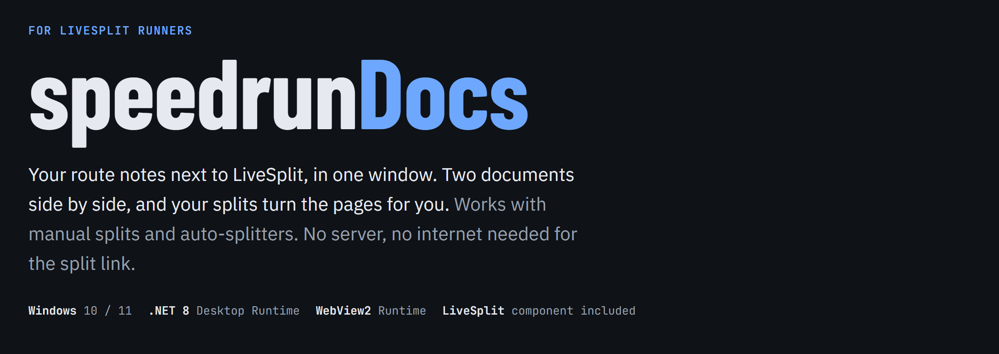
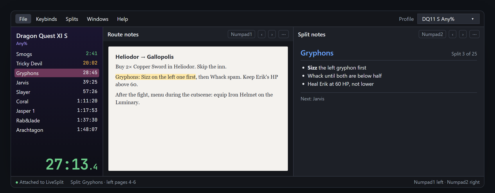

> [!IMPORTANT]
> speedrunDocs is 100% vibecoded: every part of it was written with AI. It works for me, but there may be bugs.

<a href="https://chow-zter.github.io/SpeedrunDocs/"></a>

<p align="center">
  <a href="https://github.com/Chow-zter/SpeedrunDocs/releases/latest"><b>Download the latest release</b></a>
  &nbsp;·&nbsp;
  <a href="https://chow-zter.github.io/SpeedrunDocs/"><b>Read the full guide</b></a>
  &nbsp;·&nbsp;
  <a href="https://www.youtube.com/watch?v=plkc7PyD4to"><b>Watch the video</b></a>
</p>



<sub>At the Gryphons split, the left side has jumped to its pages and the right side shows that split's notes.</sub>

## Get started

1. Download `speedrunDocs-x.x.zip` from [Releases](https://github.com/Chow-zter/SpeedrunDocs/releases/latest), unzip it anywhere and double-click `speedrunDocs.exe`. If Windows asks for the [.NET 8 Desktop Runtime](https://dotnet.microsoft.com/download/dotnet/8.0) or the [WebView2 Runtime](https://developer.microsoft.com/microsoft-edge/webview2/), install them.
2. Open a document on each side with **File › Change left document**. Paste a Google Docs, Google Sheets or ChatGPT share link and press <kbd>Enter</kbd>, or press **Import file**. Google documents must be shared as **Anyone with the link**; there's no Google sign-in.
3. Press <kbd>Numpad1</kbd> or <kbd>Numpad2</kbd> to turn the left or right side to its next page, from any program, even during the game.

Imported files can be docx, doc, odt, rtf, pdf, xlsx, ods, txt, md, html, csv, json, epub, or Google's web-page zip. They're kept as read-only copies, so you can delete the download afterwards.

## Let your splits turn the pages

speedrunDocs listens to LiveSplit through a small component. It only writes a local file: nothing goes through a server or the internet. It works the same with manual splits and auto-splitters.

**One-time setup, for each layout you use**

1. With LiveSplit closed, copy `SpeedrunDocs.dll` into LiveSplit's `Components` folder.
2. Right-click LiveSplit, choose **Edit Layout**, press **+**, then **Other**, then **SpeedrunDocs**, then **OK**.
3. Right-click LiveSplit and choose **Save Layout**.

**Choose the pages for each split**

Open **Splits › Edit split pages** and type the pages for each side, like `1-3` or `4,5,9`. Flip to a page and press **Add current** to fill it in. An empty box keeps the pages from the split before, so one set can cover several bosses.

Then turn on **Attached to LiveSplit** with the button in the top bar (or **Splits › Attach to LiveSplit**, or a key you set in Keybinds). Each split jumps to the first of its pages, and the page keys loop through only that split's pages.

> [!NOTE]
> Page numbers for splits work on imported files and Google Docs. Sheets and ChatGPT pages scroll one screen at a time.

## Split notes

No document? Type or paste notes straight into each split. A side set to split notes shows the current split's notes and, while **Splits › Attach to LiveSplit** is ticked, changes the moment you split. Unticked, it stays put. Either way, the page key scrolls through the notes and then moves on to the next split's notes; while attached, your next split brings the side back to the split you're on.

1. Open **Splits › Edit split notes** and pick the left or right side at the top.
2. Every split from LiveSplit is listed. Choose one and paste its notes. <kbd>Alt</kbd>+<kbd>↓</kbd> moves to the next split, and a dot marks splits that already have notes.
3. The preview shows the notes at the size that side has with speedrunDocs maximised, and warns you when they don't fit on one screen.
4. On the side, open **⋯ › Show split notes here**.

<table>
<tr><th>You type</th><th>The side shows</th></tr>
<tr>
<td>

```md
# Gryphons
- **Sizz** the left gryphon first
- Whack until both are below half
- Heal Erik at 60 HP, not lower
```

</td>
<td>

### Gryphons
- **Sizz** the left gryphon first
- Whack until both are below half
- Heal Erik at 60 HP, not lower

</td>
</tr>
</table>

Lines stay as typed. `**bold**`, `# headings` and `- lists` also work. Long notes scroll with the page key.

**Pictures:** take a screenshot with <kbd>Win</kbd>+<kbd>Shift</kbd>+<kbd>S</kbd> and press <kbd>Ctrl</kbd>+<kbd>V</kbd> in the notes box, press **Add picture**, or drag picture files onto the box (png, jpg, gif, bmp, webp). Pictures fit the width of the side and are saved with your profiles.

## Keybinds

| Key | What it does |
| --- | --- |
| <kbd>Numpad1</kbd> | Next page on the left side |
| <kbd>Numpad2</kbd> | Next page on the right side |
| Not set | Previous page, left or right side. Set them in **Keybinds › Edit keybinds**. |
| <kbd>Ctrl</kbd>+<kbd>S</kbd> | Save the open profile |
| <kbd>Ctrl</kbd>+<kbd>Shift</kbd>+<kbd>S</kbd> | Save as a new profile |
| <kbd>Ctrl</kbd>+<kbd>O</kbd> | Open a profile file |

Page keys work from any program, including the game. Num Lock must be on for numpad keys. A key another program already uses shows as **taken**; pick a different one. While speedrunDocs has a key, LiveSplit doesn't get it, so a key that's also one of LiveSplit's keys shows in red, for example <kbd>Numpad2</kbd> (LiveSplit's Undo). Pick keys LiveSplit doesn't use.

## Profiles

A profile keeps both documents, their names, which sides are shown, the split pages and the split notes. Switch between them with the Profile box in the top right.

- **Saved where you choose:** one folder per profile, with copies of any imported files. Set it in **File › Profiles folder**.
- **Safe from updates:** keep that folder outside the program's folder. Updating or deleting speedrunDocs never touches it.
- **Easy to share:** copy a profile folder to another PC and open its `profile.json` with <kbd>Ctrl</kbd>+<kbd>O</kbd>.
- **Undoable deletes:** deleting a profile sends its folder to the Recycle Bin.

## The window

| Where | What's there |
| --- | --- |
| **File** | Change documents, profiles, dark docs |
| **Keybinds** | Your page keys, and the window to change them |
| **Splits** | Attach to LiveSplit, split pages, split notes |
| **Windows** | Show LiveSplit beside the documents, on the left or right; show or hide each side; LiveSplit's location |
| **⋯ on a side** | Change document, import file, split notes, reload, rename, hide this side |
| **Status bar** | Attached or not, the current split and its pages, your page keys |

Drag the line between the documents to resize them. **File › Dark docs** darkens the documents themselves; pictures keep their colours. **Help › Getting started** opens this guide inside the program.

## If something isn't working

<details>
<summary><b>Splits don't move the pages</b></summary>

- Check that **Splits › Attach to LiveSplit** is ticked.
- Check that SpeedrunDocs is in the layout you're using, and that you saved the layout.
- If **Edit split pages** shows no splits, LiveSplit isn't connected yet.
- **Help › Open error log** shows any component errors.

</details>

<details>
<summary><b>A key shows "taken"</b></summary>

Another program already uses that key. Choose a different one in **Keybinds › Edit keybinds**.

</details>

<details>
<summary><b>A document side stays blank</b></summary>

The side says why it couldn't open the document. Use **⋯ › Reload**, or import the file again.

</details>

---

<sub>Settings are stored in <code>%LOCALAPPDATA%\SideDocs</code>, and profiles in the folder you choose.</sub>
